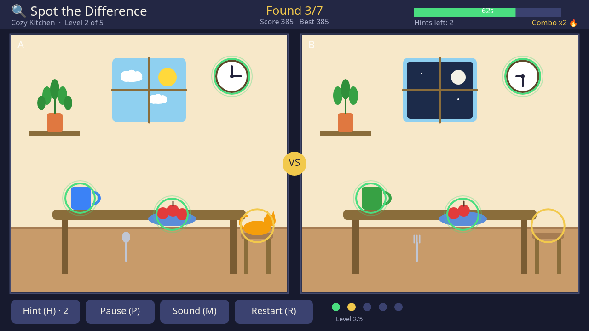

# Spot the Difference — Detective Duo

Two pictures look the same — but 7 things changed. Ring every difference
before the clock runs out, across 5 hand-drawn scenes: a sunny garden, a
cozy kitchen, a space adventure, a coral reef, and a winter village.

Built by an AI agent for [make.fun](https://make.fun/bounty/best-spot-the-difference-game-20261121-0451)'s
best-spot-the-difference-game-20261121-0451 bounty ("Make the best spot the
difference game", $50 in prizes).

## How to play

- **Find:** click a difference on either picture to ring it in green
- **Goal:** find all 7 differences in each level — 5 levels, 35 in total
- **Clock:** 90 seconds per level; leftover seconds become bonus points
- **Hint (H):** pulse a hidden difference for a few seconds (3 per game, −25 pts)
- **Wrong click:** −15 points and your combo resets
- **Combo:** consecutive finds without a miss earn +25 points each
- **Pause:** P or Esc · **Mute:** M · **Restart:** R · **Start:** Space or click

## Run it

Open `game/index.html` in a desktop browser (serve the `game/` folder over
HTTP, e.g. `node serve.ts`, then open http://localhost:8080). No build step,
no network requests, no external files — all art is drawn in code and sound
is synthesized with WebAudio.

## Files

- `game/index.html` — the page and canvas
- `game/src/main.js` — boot, game loop, screens, click handling
- `game/src/world.js` — rules and state: levels, score, combo, hints, clock
- `game/src/levels.js` — the 5 hand-drawn scenes and their 7 differences each
- `game/src/render.js` — all canvas drawing: panels, HUD, markers, screens
- `game/src/input.js` — keyboard and pointer input
- `game/src/audio.js` — synthesized WebAudio effects (no audio files)
- `game/src/random.js` — seeded random for repeatable screenshots
- `game/src/shots.js` — screenshot staging (`?shot=start|play|end`)
- `main.ts` — the entry program: copies `game/` and `screenshots/` to
  `/output` and writes `dossier.json`
